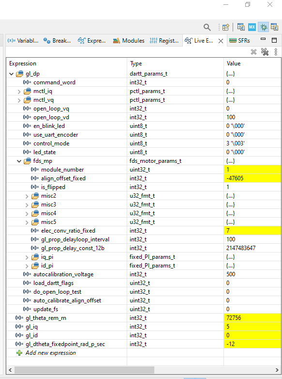

# Calibration Procedure
## Introduction
This motor controller firmware uses DARTT memory structures for many functions, including all control modes (sinusoidal, foc, openloop, position over sinusoidal, position over foc). Certain key functions such as the autocalibration subroutine and open loop commutator are accessed through DARTT as well. Because of this, it is extremely convenient to control the motor during initial calibration using the STM32CUBEIDE Live Expressions feature.

## Live Expressions
With a fully wired up & soldered motor, flash the MCU and start a debugging session. In the debug window, go to the live expressions pane. If not already done, add the following variables to the live expressions:
- `gl_dp` - this is the dartt memory. All control interfaces are routed through here
- `gl_theta_rem_m` - the position of the motor, useful for verifying encoder, etc
- `gl_iq` and `gl_id` - the currents of the motor
- `((gl_spi_angle*PI_14B)>>13)` if on V7-R3 and using the AMS encoder - tells the raw encoder output, scaled to 14bit math

Hit 'run' on the debugging session. You should immediately see the values of the feedback terms changing. Expand the gl_dp and fds_mp dropdowns.

## Motor Testing and Calibration

### Inverter Check
To check the inverter is functioning properly, first set the `do_open_loop_test` flag to `1`, then set the `load_dartt_flags` to `1`. In this controller, many flag checks are masked behind `load_dartt_flags` to save on compute during commutation, so this second load is required. The motor should spin in open loop for 10 seconds. Adjust the `open_loop_vd` value up or down as required to get good motion, if desired.

### Polepair Count, ID lock
To get the number of pole pairs, set the `control_mode` to `4` or `OPEN_LOOP_MODE`. Manually rotate the motor - you should feel distinct 'cogs' or 'clicks' from the poles passing over the magnetized stator. The number of these cogs per one full rotation is the number of pole-pairs. 

Set `elec_conv_ratio_fixed` to the number of pole pairs. If on V7-R3, set `align_offset_fixed` to the value in the `((gl_spi_angle*PI_14B)>>13)` row.

Finally, update the filesystem by setting `update_fs = 1` followed by `load_dartt_flags = 1`.

IMPORTANT NOTE: It is recommended to use some value of `align_offset_fixed` which is far away from zero. This appears to yield superior numerical stability in the commutation loop.

### Commutation Test

The next step is to attempt to commute the motor. Set the command word to a small value (say, `command_word = 100`). Set the `control_mode` to `1`. The motor should start spinning gently. If it does not, try manually backdriving it. If the phases are wrong, backdriving will feel similar to the cogging experienced during the polepair count, except with many more 'cogs' per rotation. To resolve this issue, change the `is_flipped` flag to the opposite of whatever it currently is (`0` or `1`).

If the above doesn't work, there may be a hardware issue. Setting the polepair count, align offset, and flipped flag correctly, should cause the motor to spin when the control mode and command word are set.

### Autocalibration

Once a rough `align_offset_fixed` is obtained, you can refine it further using autocalibration. Set the `auto_calibrate_align_offset = 1` followed by `load_dartt_flags = 1`. The motor will take over, spinning back and forth until it converges on the optimal commutation offset. You will get more accurate results for higher values of `autocalibration_voltage` - however this may result in very high current draw if the motor is not configured properly, so do so only if you believe you're close to the proper `autocalibration_voltage`. It is recommended to repeat the autocalibration routing while increasing the voltage incrementally. You can watch the converged result in `gl_dp.fds_mp.align_offset_fixed`.

### FOC Calibration and Fine Tuning

Once calibrated, you may want to adjust the FOC PID gains manually for better performance with your specific motor. This is accomplished via the `gl_dp.fds_mp.iq_pi` and `gl_dp.fds_mp.id_pi`. You can test them by putting the motor in foc mode (`control_mode = 0`) and set a tracking point with `command_word`.
